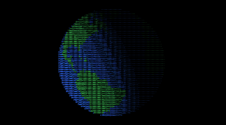

# ASCII Earth: An ASCII 3D World Map with live solar illumination

[](https://marcelrochera00.github.io/ascii-earth-web/)
[](https://www.npmjs.com/package/ascii-earth)
[](LICENSE.md)

A rotating 3D Earth drawn with ASCII characters on a canvas, lit by the real position of the sun. Built with TypeScript and based on my previous attempt at this using Python ([ascii-earth](https://github.com/MarcelRochera00/ascii-earth)).

[](https://marcelrochera00.github.io/ascii-earth-web/)


## Features

- **Smooth animation:** Pre-allocated buffers and off-screen canvas glyph caching to prevent garbage collection stutters.
- **Accurate Solar Lighting:** Surface luminance computed dynamically based on the sun's position.
- **Zero Dependencies:** Pure TypeScript implementation of 3D math, ray-sphere intersections, and spherical projections.
- **Self-Contained:** Embedded compressed map data using Base64 and bit unpacking.

## Installation

```bash
npm install ascii-earth
```
## Usage

```ts
import { AsciiEarth } from "ascii-earth";

const canvas = document.querySelector("canvas")!;

const earth = new AsciiEarth(canvas, {
  speed: 0.025,
  tilt: 0.41,
});

earth.start();
```

## Configuration Options and Setters

When instantiating `AsciiEarth`, you can pass an options object to customize its behavior. You can also modify these parameters dynamically using the provided chainable setters (e.g., `earth.speed(0.03)`).

| Option | Type | Default | Description |
| :--- | :--- | :--- | :--- |
| `width` | `number` | `1280` | Custom internal canvas grid width. |
| `height` | `number` | `720` | Custom internal canvas grid height. |
| `speed` | `number` | `0.025` | Controls the rotation speed of the Earth per frame. |
| `tilt` | `number` | `0.35` | Axial tilt of the planet. |
| `landColor` | `[number, number, number]` | `[70, 220, 100]` | RGB color tuple for land. |
| `waterColor` | `[number, number, number]` | `[50, 110, 255]` | RGB color tuple for oceans/water. |
| `showMap` | `boolean` | `true` | Toggle visibility of the geographic map details. |

## Architecture and Documentation

If you want to know how the rendering loop avoids memory allocations, how NumPy math was ported to native JavaScript Typed Arrays, or how the map data is unpacked from Base64, check out the [ARCHITECTURE.md](https://github.com/MarcelRochera00/ascii-earth-web/blob/main/ARCHITECTURE.md) file.

 ## License


MIT 
